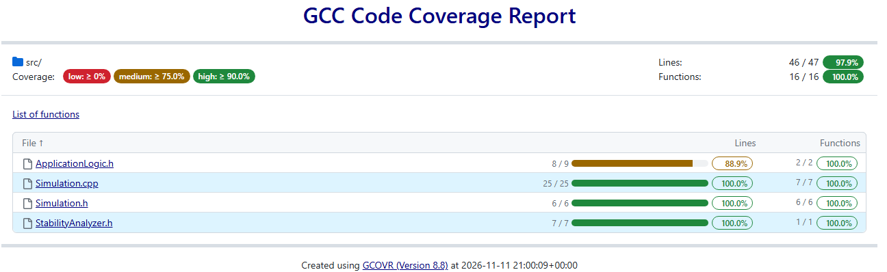

<p align="center"> Министерство образования Республики Беларусь</p>
<p align="center">Учреждение образования</p>
<p align="center">“Брестский Государственный технический университет”</p>
<p align="center">Кафедра ИИТ</p>
<br><br><br><br><br><br><br>
<p align="center">Лабораторная работа №2</p>
<p align="center">По дисциплине “Общая теория интеллектуальных систем”</p>
<p align="center">Тема: “Модульные тесты”</p>
<br><br><br><br><br>
<p align="right">Выполнил:</p>
<p align="right">Студент 2 курса</p>
<p align="right">Группы ИИ-30</p>
<p align="right">Сарайкин Н. Н.</p>
<p align="right">Проверил:</p>
<p align="right">Дворанинович Д. А.</p>
<br><br><br><br><br>
<p align="center">Брест 2026</p>


# OTIS — лабораторная работа №2

**Вариант:** 7 
**Предыдущая работа:** лабораторная работа №1  
**Язык:** C++17  
**Тестовый фреймворк:** Google Test, Google Mock

## 1. Цель

Дополнить разработанное в рамках лабораторной работы №1 программное обеспечение компонентом для исследования устойчивости линейной дискретной динамической системы, а также реализовать автоматизированное тестирование корректности математических алгоритмов с применением модульных тестов. Процессы компиляции, выполнения тестовых наборов и генерации аналитических отчетов автоматизированы на локальной машине с использованием системы сборки CMake и командного сценария `run_tests.bat`.

## 2. Математические модели

В проекте сохранены три модели из лабораторной работы №1:

| Модель | Тип | Уравнение |
|---|---|---|
| Model 1.1 | Линейная дискретная модель | $y_{k+1} = a \cdot y_k + b \cdot u_k$ | |
| Model 2.5 | Нелинейная дискретная модель | $y_{k+1} = a \cdot y_k + b \cdot \operatorname{sgn}(u_k) \cdot \left(1 - e^{-\|u_k\|}\right)$ | |
| Model 3.9 | Дифференциальная модель | $y_{k+1} = y_k + b \cdot \tanh(u_k) \cdot \Delta t$ | |

Для исследования переходных процессов реализована генерация трёх типовых вариантов входного управляющего сигнала $u_k$:   Step (Ступенчатый) — постоянное скачкообразное воздействие заданной амплитуды:$$u_k = U = \text{const}$$   Impulse (Импульсный) — кратковременное единичное воздействие на начальном такте с последующим спадом до нуля:$$u_0 = U, \quad u_k = 0 \quad (\forall k > 0)$$   Harmonic (Гармонический) — периодическое синусоидальное воздействие:$$u_k = A \cdot \sin(k)$$   Вычислительное ядро выполняет итерационный пошаговый расчет траектории фазовой координаты $y_k$, осуществляет вывод результатов в консоль и экспортирует временные ряды в файл формата .csv для последующего построения графиков динамики переходных характеристик.   

## 3. Анализ устойчивости Model 1.1

Оценка устойчивости линейной дискретной системы выполняется при исследовании свободного движения, то есть при нулевом управляющем сигнале ($u_k = 0$):

$$y_{k+1} = a \cdot y_k$$

Подстановка общего решения вида $y_k = C \cdot z^k$ (где $C \neq 0$) приводит к характеристическому уравнению первого порядка на комплексной $Z$-плоскости:

$$z - a = 0 \implies z_1 = a$$

Дискретная линейная модель обладает свойством асимптотической устойчивости тогда и только тогда, когда корень характеристического уравнения строго располагается внутри единичного круга:

$$\vert{}z_1\vert{} = \vert{}a\vert{} < 1$$

Граничные состояния $\vert{}a\vert{} = 1$ соответствуют границе устойчивости и классифицируются анализатором как неустойчивые. Модуль верификации осуществляет проверку входных параметров, отсеивает некорректные и бесконечные значения (`NaN`, `Inf`) и выводит предупреждающее сообщение в консоль до начала расчетного цикла симуляции, если система неустойчива.

Разработанный аналитический критерий применим исключительно к линейной модели (Model 1.1). Для нелинейных систем (Model 2.5) и дифференциальных моделей (Model 3.9) требуются специализированные методы анализа устойчивости.

## 4. Структура проекта

```text
task_02/
├── CMakeLists.txt                  # конфигурация cmake
├── doc/
│   └── readme.md                   # отчет по работе
├── src/
│   ├── ApplicationLogic.cpp        # логика симуляции
│   ├── ApplicationLogic.h          # заголовочный файл логики
│   ├── CMakeLists.txt              # сборка исходного кода
│   ├── main.cpp                    # точка входа
│   ├── Simulation.cpp              # реализация математических моделей
│   ├── Simulation.h                # заголовочный файл моделей
│   ├── StabilityAnalyzer.cpp       # реализация анализа устойчивости
│   └── StabilityAnalyzer.h         # заголовочный файл анализатора
└── test/
    ├── build.bat                   # сборка тестов
    ├── CMakeLists.txt              # конфигурация сборки тестов
    ├── CMakePresets.json           # пресеты cmake
    ├── run_tests.bat               # запуск тестов и отчета
    ├── run_tests.sh                # скрипт запуска под linux
    ├── test_simulation.cpp         # тесты моделей и логики
    └── test_stability.cpp          # тесты анализа устойчивости
```

### Назначение основных файлов

- `Simulation.h` / `Simulation.cpp` — базовый класс модели и расчет трех математических моделей варианта: Model 1.1, Model 2.5 и Model 3.9.
- `StabilityAnalyzer.h` / `StabilityAnalyzer.cpp` — вычисление корней уравнения и проверка устойчивости линейной модели.
- `ApplicationLogic.h` / `ApplicationLogic.cpp` — управление симуляцией, пошаговые вычисления и формирование входных сигналов.
- `main.cpp` — точка входа, ввод параметров пользователем и запуск симуляции.
- `test/test_simulation.cpp` — тесты моделей с разными параметрами и проверка симуляции через Google Mock.
- `test/test_stability.cpp` — проверка анализатора устойчивости для устойчивых, граничных и расходящихся случаев.
- `test/run_tests.bat` — скрипт для полной сборки, запуска тестов и создания HTML-отчета покрытия.

## 5. Сборка и запуск

### Требования

- CMake версии 3.16 или выше;
- компилятор C++ с поддержкой стандарта C++17;
- Git и доступ к интернету при первом запуске (фреймворки Google Test и Google Mock скачиваются автоматически через CMake FetchContent);
- Python 3 и утилита `gcovr` для генерации HTML-отчета о тестовом покрытии.

### Запуск в Windows

Из корневого каталога проекта необходимо выполнить:

```bat
run_tests.bat
```

Скрипт автоматически конфигурирует CMake, собирает проект и запускает тесты через CTest. При наличии утилиты `gcovr` в переменной окружения `PATH` также генерируется интерактивный HTML-отчет с данными о покрытии кода тестами.

Установка `gcovr`:

```bat
pip install gcovr
```

### Ручной запуск

Для самостоятельной сборки и выполнения тестов через терминал:

```bash
cmake -S . -B build -G "MinGW Makefiles" -DENABLE_COVERAGE=ON
cmake --build build
ctest --test-dir build --output-on-failure
```

## 6. Модульные тесты

Набор тестов разделен на два файла: `test/test_simulation.cpp` и `test/test_stability.cpp`.

| Группа тестов | Проверяемая логика |
|---|---|
| Линейная модель 1.1 | Вычисление следующего шага для разных наборов коэффициентов через параметризованные тесты `TEST_P` |
| Нелинейная модель 2.5 | Поведение при нулевом воздействии, симметрия функции насыщения для противоположных знаков входа |
| Дифференциальная модель 3.9 | Расчет шага методом Эйлера, работа функции тангенса и сохранение состояния при нулевом шаге времени `dt = 0` |
| Базовый класс модели | Проверка методов установки параметров, чтения состояния и сброса `reset()` |
| Логика симуляции | Тестирование прогона шагов с подменой источника сигналов через Google Mock (`MOCK_METHOD`) |
| Анализ устойчивости | Случаи внутри единичного круга, расходящиеся значения, граница устойчивости и проверка вывода предупреждений |

Всего в проекте реализовано 45 тестов. Для проверки моделей при различных входных данных используются параметризованные тесты (`TEST_P`), что позволяет избежать дублирования проверок.

Фреймворк Google Mock применяется для изолированного тестирования логики симуляции: создается мок-объект входного сигнала, который выдает заранее заданные значения без привязки к реальному вводу.

## 7. Тестовое покрытие и результаты

- **Способ запуска:** локальный командный скрипт `run_tests.bat`.
- **Всего запущено тестов:** 45.
- **Успешно пройдено:** 45 из 45 (100%).



Скрипт `run_tests.bat` собирает проект с флагами сбора покрытия и при наличии утилиты `gcovr` генерирует интерактивный отчет `coverage.html`.

## 8. Результаты и особенности работы

В рамках проекта реализованы три математические модели динамических систем, три вида входного сигнала, проверка устойчивости линейной модели, модульные тесты Google Test с параметризацией через `TEST_P`, изоляция зависимостей с помощью Google Mock и скрипты автоматизации сборки.

Корректность работы алгоритмов подтверждается локальным запуском `run_tests.bat`. Для сборки и генерации отчета необходимы компилятор C++17, CMake и утилита `gcovr`.

## Выводы

В ходе лабораторной работы программа была расширена модулем анализа устойчивости и полным набором модульных тестов на базе Google Test и Google Mock:

- реализован модуль анализа устойчивости линейной модели (Model 1.1): по характеристическому корню $z_1 = a$ проверяется нахождение системы внутри единичного круга ($|a| < 1$). Граничные значения $|a| = 1$ считаются неустойчивыми. Если параметры дают неустойчивую систему, программа выводит предупреждение до запуска расчета;
- написано 45 модульных тестов, которые успешно прошли проверку со 100% результатом;
- для проверки математических моделей при различных входных параметрах применены параметризованные тесты (`TEST_P`), исключающие дублирование кода;
- логика симуляции и генерация входных сигналов (ступенчатого, импульсного и гармонического) протестированы изолированно с помощью мок-объектов Google Mock;
- отдельно подтверждена корректность работы нелинейной модели в состоянии покоя при $u = 0$, симметрия нелинейной части и поведение дифференциальной модели при нулевом шаге $dt = 0$.